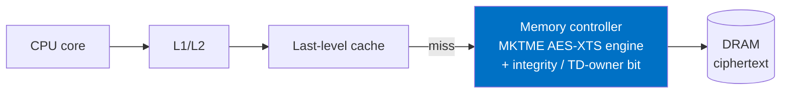
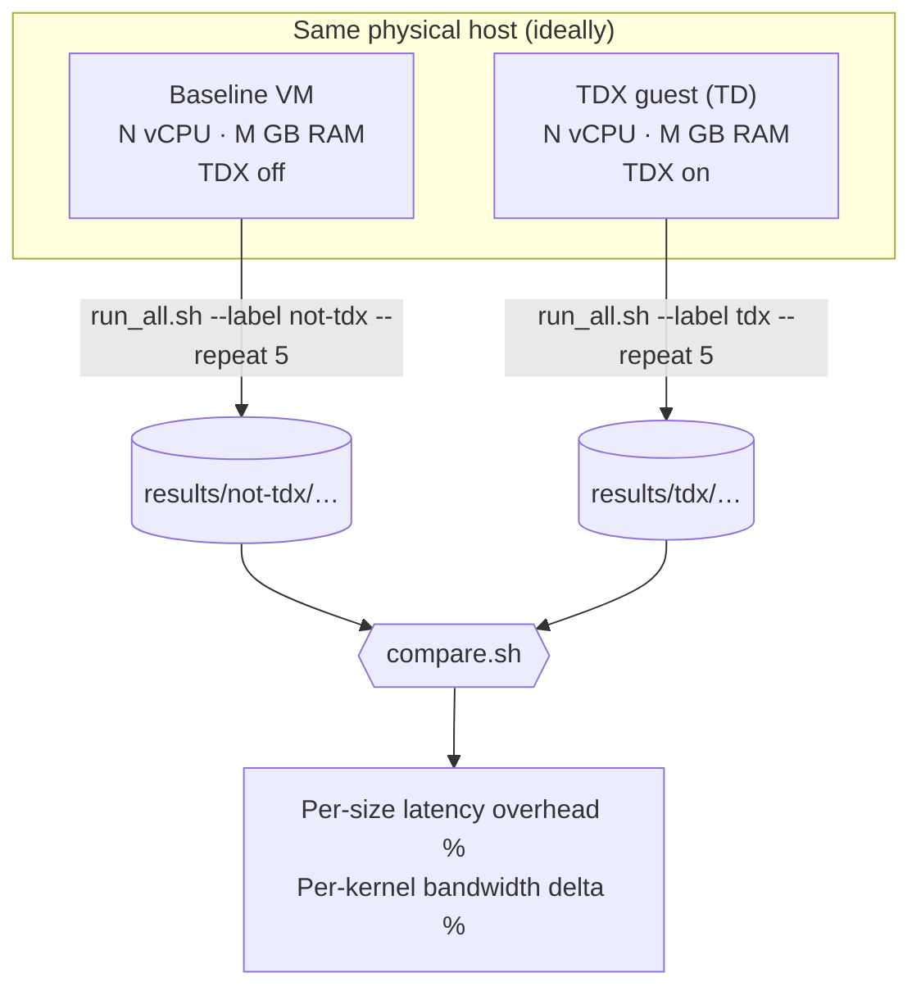

<div align="center">

# 🧠 ram-bench-suite

**How much does Intel TDX memory encryption cost you, in nanoseconds?**

A small, dependency-light benchmark suite that measures RAM **latency** and **bandwidth**
inside a confidential **Intel TDX** guest and compares it against an identical
**non-TDX** VM.


</div>

---

## Table of contents

- [Background: why TDX should cost something](#background-why-tdx-should-cost-something)
- [Methodology](#methodology)
  - [1. Experimental design](#1-experimental-design)
  - [2. Latency: pointer chasing over a random cycle](#2-latency-pointer-chasing-over-a-random-cycle)
  - [3. Working-set sweep](#3-working-set-sweep)
  - [4. Bandwidth: STREAM-style kernels](#4-bandwidth-stream-style-kernels)
  - [5. Cross-checks: sysbench and Intel MLC](#5-cross-checks-sysbench-and-intel-mlc)
  - [6. Environment capture](#6-environment-capture)
  - [7. Repetition and aggregation](#7-repetition-and-aggregation)
- [Quick start](#quick-start)
- [Repository layout](#repository-layout)
- [Interpreting your own results](#interpreting-your-own-results)
- [Limitations and threats to validity](#limitations-and-threats-to-validity)

---

## Background: why TDX should cost something

Intel **Trust Domain Extensions (TDX)** isolate a VM (a *trust domain*, TD) from the
host and hypervisor. Several parts of this design sit on the path every memory
access takes:



- **Inline memory encryption (MKTME / TME-MT).** Cache lines are decrypted and
  encrypted with a per-TD AES-XTS key in the memory controller. Data inside the
  caches is plaintext, so **the cost only appears on a cache miss**.
- **Integrity / ownership tracking.** TDX attaches metadata to each cache line
  (the TD-owner bit, and optionally cryptographic integrity) and checks it on
  every DRAM access.
- **Secure EPT.** Guest-physical to host-physical translation goes through
  TDX-module-managed page tables, so TLB misses and page walks can cost more too.

The expected pattern follows from this: **little or no overhead while the working set
fits in cache, and a step up once accesses spill to DRAM.** The suite is built
to show that step and to measure how large it is.

---

## Methodology

### 1. Experimental design

The setup is an **A/B comparison** in which the only intended variable is whether TDX
is enabled.



Controls applied to keep the comparison fair:

| Control | How |
|---|---|
| Same hardware | Both VMs on the same physical host, same BIOS/firmware settings |
| Same VM shape | Same vCPU count and topology, same amount of RAM, same guest kernel |
| Same binaries | The C sources are compiled **inside each VM** with the same `gcc -O2` flags |
| Stable clocks | `setup.sh` sets the cpufreq governor to `performance` where the guest exposes it |
| No page-fault noise | Every page is touched before the timed region starts |
| Run-to-run noise | `--repeat N` repetitions, averaged by `compare.sh` |
| Verified TDX status | `system_info.txt` records the `tdx_guest` CPU flag and `tdx:` dmesg lines, which proves which VM was which |

### 2. Latency: pointer chasing over a random cycle

**Source:** [`src/latency_chase.c`](src/latency_chase.c)

Latency is the **primary metric**. Encryption adds a fixed cost to each DRAM
access, and that cost shows most clearly when accesses cannot be overlapped.

**How it works**

1. **Allocate** an array of `n = size / 8` 64-bit slots, page-aligned
   (`aligned_alloc(4096, …)`).
2. **Build a single random cycle** with **Sattolo's algorithm**: start from the
   identity permutation and, for `i = n-1 … 1`, swap `arr[i]` with `arr[j]` where
   `j ∈ [0, i-1]`. Unlike a plain Fisher–Yates shuffle, Sattolo's variant
   always produces **one cycle covering all `n` elements**. There are no fixed
   points and no short sub-cycles, so the chase really visits the whole working set
   instead of looping inside a small, cache-resident subset.
   Randomness comes from a seeded `xorshift64` PRNG, so runs are reproducible.
3. **Pre-fault** every 4 KB page, which keeps first-touch page faults (and, on TDX,
   lazy page *acceptance*) out of the measurement.
4. **Warm up** with `accesses / 10` hops.
5. **Time** `accesses` dependent loads with `CLOCK_MONOTONIC`:

   ```c
   for (k = 0; k < accesses; k++) p = arr[p];   // next address = this load's value
   ```

   Each load's address depends on the value of the previous load, so the CPU
   **cannot issue them in parallel**, and the random order **defeats the
   hardware prefetchers**. `p` is `volatile`, so the compiler cannot remove the loop.
6. **Report** `elapsed_ns / accesses`, the average **ns per dependent access**,
   as a `size_bytes,ns_per_access` CSV line.

```
 arr: [ 5 | 3 | 7 | 0 | 1 | 6 | 2 | 4 ]      one cycle: 0→5→6→2→7→4→1→3→0
        ▲                                     every hop is a dependent load
        └── p = arr[p]  ── stall until DRAM answers ──► next hop
```

### 3. Working-set sweep

**Driver:** [`run_latency.sh`](run_latency.sh)

The pointer chase runs over **11 working-set sizes** from 4 KB to 4 GB in ×4 steps.
This covers every level of the memory hierarchy, and the cache levels act as
built-in controls where TDX *should* make no difference:

| Size | Typical level | Timed accesses |
|---|---|---|
| 4 KB, 16 KB | L1d | 50 M |
| 64 KB, 256 KB, 1 MB | L2 | 50 M |
| 4 MB, 16 MB | L2 → L3 | 50 M |
| 64 MB, 256 MB | L3 → DRAM (CPU-dependent) | 5 M |
| 1 GB, 4 GB | DRAM | 5 M |

All sizes above a few MB also miss the TLB on most hops. The real levels depend on the CPU,
so read them off your own latency curve.

Small sizes run 10× more iterations because each hop is cheap, and the higher
count keeps timer resolution from dominating.

### 4. Bandwidth: STREAM-style kernels

**Source:** [`src/bandwidth_stream.c`](src/bandwidth_stream.c) · **Driver:** [`run_bandwidth.sh`](run_bandwidth.sh)

Bandwidth is a **secondary metric**. Sequential streams are prefetch-friendly and
keep many requests in flight, which hides much of the per-access encryption latency.
The suite reimplements the four classic
[STREAM](https://www.cs.virginia.edu/stream/) kernels:

| Kernel | Operation | Bytes moved / element |
|---|---|---|
| Copy  | `c[i] = a[i]` | 16 |
| Scale | `b[i] = s · c[i]` | 16 |
| Add   | `c[i] = a[i] + b[i]` | 24 |
| Triad | `a[i] = b[i] + s · c[i]` | 24 |

- 3 arrays × **64 Mi doubles = 512 MB each** (1.5 GB total), far larger than any
  LLC, so the kernels stream from DRAM.
- 10 iterations. Each kernel is timed separately, and MB/s = `bytes × iters / time`.
- Single-threaded, so the result reflects **per-core** sustainable bandwidth rather than socket bandwidth.

### 5. Cross-checks: sysbench and Intel MLC

- **sysbench memory** (`run_bandwidth.sh`): 64 GB of 1 MB-block reads and writes,
  run as an independent sanity check. Note that a 1 MB block is largely
  **cache-resident**, so this mostly measures cache bandwidth and is *expected* to show
  little TDX difference.
- **Intel Memory Latency Checker** (`run_mlc.sh`): if `mlc` is on `PATH`, the
  suite also records `--idle_latency`, `--bandwidth_matrix` and
  `--loaded_latency`. MLC is Intel's reference tool for this kind of measurement
  and is what Intel's own TDX performance material uses. MLC requires a
  license-gated download, so the step is skipped when it is not installed.

### 6. Environment capture

At the start of each run, `run_all.sh` writes `system_info.txt` containing:

- `lscpu`: CPU model, cache sizes (to locate the LLC boundary) and flags
- `/proc/meminfo`, including `Unaccepted:` memory on TDX guests
- `dmesg | grep tdx`, e.g. `Memory Encryption Features active: Intel TDX`
- presence of the `tdx_guest` CPU flag

This makes each result directory **self-describing**: it is always possible to
prove that a run came from a real TD.

### 7. Repetition and aggregation

**Aggregator:** [`compare.sh`](compare.sh)

- Each `--repeat` creates `rep1/ … repN/` with `latency.csv` and `bandwidth.csv`.
- `compare.sh` takes the **arithmetic mean** across repetitions for every size and kernel,
  then reports:

  ```
  latency overhead  = (TDX − baseline) / baseline × 100     (higher = worse)
  bandwidth delta   = (TDX − baseline) / baseline × 100     (lower  = worse)
  ```

---

## Quick start

> **Requirements:** Linux guest, `bash`, `gcc`, `python3`. `sysbench`, `numactl` and Intel MLC are optional.

```bash
git clone <this repo> && cd ram-bench-suite

# 1. One-time setup on EACH VM (installs gcc/sysbench, sets CPU governor)
sudo ./setup.sh

# 2a. On the baseline (non-TDX) VM
./run_all.sh --label not-tdx --repeat 5

# 2b. On the TDX guest
./run_all.sh --label tdx --repeat 5

# 3. Copy both result dirs to one machine and compare
./compare.sh results/not-tdx/<timestamp> results/tdx/<timestamp>
```

Each `run_all.sh` prints its output directory. A full pass takes a few minutes per repetition.

> ⚠️ The latency sweep allocates up to **4 GB** and the bandwidth test about **1.5 GB**. On
> smaller VMs, trim `SIZES_KB` in `run_latency.sh` and `ELEMENTS` in `run_bandwidth.sh`,
> keeping at least 2–3 sizes past the LLC.

### Individual tools

```bash
./run_latency.sh   out.csv        # sweep only
./run_bandwidth.sh out.csv        # STREAM + sysbench only
./run_mlc.sh       out_dir/       # Intel MLC only (if installed)

# raw binaries
bin/latency_chase   <size_bytes> <accesses> [seed]   # → size_bytes,ns_per_access
bin/bandwidth_stream <elements> <iterations>         # → kernel,MBps
```

---

## Repository layout

```
ram-bench-suite/
├── setup.sh               # one-time: deps + 'performance' CPU governor
├── run_all.sh             # orchestrator: system snapshot + N repetitions, labelled
├── run_latency.sh         # compiles & runs the 4 KB → 4 GB pointer-chase sweep
├── run_bandwidth.sh       # compiles & runs STREAM-like kernels + sysbench cross-check
├── run_mlc.sh             # Intel MLC idle/loaded latency + bandwidth matrix (optional)
├── compare.sh             # baseline vs TDX: mean over reps, % overhead tables
├── lib/common.sh          # logging / helper functions
├── src/
│   ├── latency_chase.c    # Sattolo single-cycle pointer chase
│   └── bandwidth_stream.c # Copy / Scale / Add / Triad
└── results/<label>/<timestamp>/
    ├── system_info.txt    # lscpu, meminfo, TDX evidence
    └── rep<N>/            # latency.csv, bandwidth.csv, sysbench_*.txt, mlc_*.txt
```

---

## Interpreting your own results

1. **Find the LLC size** in `system_info.txt`. Inside VMs the reported cache topology
   may be synthetic and can differ between the two guests, so a better guide is where
   the latency curve itself jumps (typically a 2–3× step into DRAM).
2. **Treat small-size "overhead" as an offset.** Data in L1/L2 never reaches the memory
   controller, so any difference there is not encryption. If it is consistent across
   repetitions, it is a systematic offset (clock or virtualization differences) that
   every other row also includes.
3. **Don't attribute the mid-range to encryption.** Between the L2 size and the point
   where the curve jumps to DRAM, accesses are mostly served by L3, and any overhead there
   is more likely TLB-miss, page-walk (Secure EPT) and virtualization cost.
4. **Read the plateau.** The overhead percentage at the largest sizes, where it stops
   growing, is the answer to *"how much latency does TDX add?"*. It is an end-to-end
   figure (DRAM encryption plus TLB misses and page walks), not pure AES latency.
5. **Expect bandwidth to suffer less than latency.** Streaming accesses overlap and hide
   per-line latency, so pointer-heavy workloads (databases, key-value stores, graph
   traversal) feel TDX more than streaming or compute-bound ones.
6. **Look at the spread.** If the standard deviation across repetitions is comparable to the
   difference you are reading, run more repetitions (`--repeat 10`).

---

## Limitations and threats to validity

- **Same-host assumption.** Results are only meaningful if both VMs run on the
  same hardware with the same BIOS/firmware settings. Otherwise the comparison measures
  platform differences instead of TDX. `system_info.txt` records the CPU model but
  cannot prove both guests ran on the same host.
- **Concurrent runs.** Running both VMs at the same time makes them compete for the
  host's memory bandwidth and LLC. Run them one at a time.
- **Guests can differ in more than TDX.** Compare the two `system_info.txt` files:
  differences in physical address width, exposed cache topology or RAM size can also
  contribute to the measured gap.
- **No vCPU pinning by default.** Scheduler migrations and noisy neighbours add
  variance. For tighter numbers, pin with `taskset`/`numactl` on both the host and the guest.
- **Page size not controlled.** The benchmark does not request huge pages, and the
  guest's THP setting is not recorded, so large sizes probably combine DRAM latency with
  TLB-miss and page-walk cost. Running with `madvise(MADV_HUGEPAGE)` or hugetlbfs would separate the two.
- **Single-threaded.** Neither benchmark measures loaded latency or full-socket
  bandwidth. Intel MLC's `--loaded_latency` and `--bandwidth_matrix` cover that when available.
- **Simplified STREAM.** The kernels are not the official STREAM binary (no OpenMP,
  `-O2` only), so absolute MB/s values should not be compared with published STREAM
  results. Only the relative A/B delta is meaningful.
- **Mean, not median.** `compare.sh` averages repetitions, so a single outlier
  can shift a row. Check the per-rep CSVs if a value looks odd.
- **Platform-specific.** Results apply to the CPU generation, TDX module version and
  memory integrity settings they were measured on.
